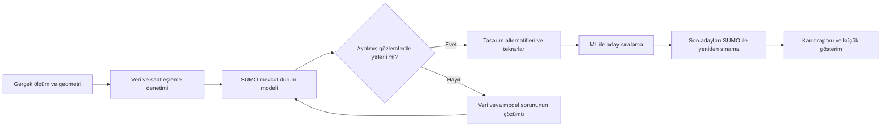

# TrafficML: küçük ve gerçek veriye dayalı pilot

5 Ekim 2026 | Karar ve uygulama yol haritası

## 1. Kararım

**İlk yapılabilirlik pilotunu Los Angeles, Universal City'deki Lankershim Boulevard üzerinde kuracağız.** Veri kaynağı FHWA'nın NGSIM saha ölçüm paketidir. Çekirdek alan, Lankershim / Universal Hollywood Drive–Campo De Cahuenga Way (ATSAC 088) ve Lankershim / Main Street–MTA Driveway (ATSAC 089) çevresidir. Müdahaleleri bu iki komşu kavşakla sınırlandıracağız; kuyruk ve sınır etkilerini görebilmek için yaklaşık 500 metrelik ölçüm koridorunun gerekli komşu bağlantılarını modelde tutacağız. Kesin sınır ve NGSIM–ATSAC kimlik eşlemesi ilk veri denetiminde sabitlenecek.

Bu seçim için belirleyici neden şehir ismi değil, aynı ölçüm döneminde araç hareketleriyle yol ve kontrol bilgilerinin birlikte bulunmasıdır. Resmî açıklama 16 Haziran 2005 ölçümünü, 0,1 saniyelik araç konumlarını ve iki ana 15 dakikalık pencereyi tanımlar. Destek paketinde geometri, kontrol ve ek ölçüm dosyaları listelenir. [FHWA alan açıklaması](https://www.fhwa.dot.gov/publications/research/operations/07029/index.cfm), [USDOT veri portalı](https://data.transportation.gov/Automobiles/Next-Generation-Simulation-NGSIM-Vehicle-Trajector/8ect-6jqj).

**Bu, arşivlenmiş gerçek saha verisiyle yapılacak bir mühendislik doğrulama pilotudur.** Yeni bir tasarımın gerçek yolda uygulanmış sonucunu ölçmüş olmayacağız. Başarı, dar bir alanda gerçek mevcut durumu yeterince açıklayan model kurulması ve tasarım karşılaştırma–ML zincirinin çalışmasıdır. Güncel Los Angeles, Helsinki veya Ankara trafiği için doğruluk iddiası bu pilotun sonucu olmayacak.

Helsinki'yi ikinci aşama için tutuyorum. LIDO-TIKU sensör kataloğu erişilebilir; ancak bu incelemede seçili gözlem indirmeleri 503/timeout verdi ve sinyal kontrol verisi tamamlanmadı. Ankara'da ise aynı kavşak ve döneme ait talep, kontrol ve doğrulama paketi henüz elde değil. Hazır Ingolstadt/Bologna senaryoları yazılım öğrenmek için yararlı; kamuya açık bağımsız saha doğrulamasını birlikte gösteremedikleri için bu ilk kanıtın temeli olarak seçilmedi. Ayrıntılar önceki [fizibilite incelemesinde](../analysis/TrafficML_Fizibilite_Analizi_2026-10-05.md).

## 2. Kanıtlayacağımız üç şey

| Kanıt | Yanıtlanacak soru | Nasıl sınayacağız? |
|---|---|---|
| Gerçek mevcut durum | Bu küçük alanda ölçülmüş trafik davranışını yeterince açıklayabiliyor muyuz? | Ayarlamada kullanılmayan zaman penceresinde seyahat süresi, çıkış sayısı ve kuyruk karşılaştırması |
| Tasarım değerlendirmesi | Kontrol ve sınırlı fiziksel değişiklikler için tutarlı karşılaştırma üretebiliyor muyuz? | Ortak talep, geçerli tasarımlar, tekrarlı SUMO koşuları, tamamlanmayan talebi de içeren sonuçlar |
| ML katkısı | Adayları değerlendirmek için daha az simülasyonla benzer seçim kalitesi elde edebiliyor muyuz? | Görülmemiş tasarım gruplarında basit yöntemlere karşı hata, aday sıralaması ve toplam süre karşılaştırması |

Bir tasarımın iyileştirme sağlaması başarı şartı değildir. Ölçümlere dayalı olarak “bu değişiklik burada işe yaramıyor” diyebilmek de geçerli sonuçtur. ML simülasyonu yaklaşıklar; gerçek dünya doğruluğunu mevcut durumun saha karşılaştırması sağlar. Alternatif tasarımların etkileri bu pilotta **model tahmini** olarak etiketlenir.

## 3. İlk pilotun kapsamı

**Dahil:** araç talebi ve dönüşler; paketin desteklediği araç sınıfları; şerit ve bağlantılar; gerçek kontrol kaydıyla mevcut durum; yeşil paylaşımı ve koordinasyon alternatifleri; mevcut yol alanı içinde bir fiziksel düzenleme ailesi; kuyruk, geçiş ve seyahat süresi; açıklanabilir ilk ML modeli; sade harita ve karşılaştırma ekranı.

**İkinci aşamaya bırakılanlar:** yaya/bisiklet etkisinin saha doğrulaması, şehir çapında dinamik rota seçimi, güncel veri akışı, bina/arazi tabanlı yeni yol açma, kamulaştırma, gerçek uygulama maliyeti, ayrıntılı 3D ve otomatik mühendislik onayı. Bunlar kaynak paketteki gereksinimlerden çıkarılmış değildir; bu ilk deneyde kanıtlanmış sayılmayacaktır.

Araç modeli için yol geometrisi ve sinyaller önce gelir. Bina görselleştirmesi veya DEM'nin tamamlanmasını beklemek ilk deneyin kanıtını güçlendirmeyecektir. Buna karşılık yol alanının dışına çıkan bir fiziksel tasarım bina, arazi ve mülkiyet verisi olmadan uygulanabilir kabul edilemez.

## 4. Veri paketi ve bugünkü erişim durumu

| Girdi | Kullanımı | Bu incelemede doğrulanan / kalan iş |
|---|---|---|
| NGSIM araç kayıtları | Giriş zamanı, rota/dönüş, sınıf, konum; gözlenen seyahat ve kuyruk | USDOT API'sinden gerçek örnek ve toplam satır sorgusu alındı. Tam Lankershim dışa aktarımı ve kalite denetimi yapılacak; bulunabilirse özgün TXT'lerle karşılaştırılacak. |
| CAD/GIS ve kavşak çizimleri | Şerit, cep, dur çizgisi, bağlantı ve algılayıcı eşlemesi | Resmî destek ZIP'i tamamen indirildi: 144.875.847 bayt. İç CAD, GIS ve kontrol arşivleri açılarak dosya envanteri doğrulandı. Geometri henüz SUMO ağına dönüştürülmedi. |
| Sinyal zamanlama sayfaları ve RSM | Kontrol parametreleri, çevrim bazında gerçekleşen paylaşım | 088'in dört ve 089'un üç sayfalık kontrol belgeleri görsel incelendi; iki kavşağın 16 Haziran RSM TXT dosyaları alındı. Ana pencerede iki kayıtta da 100 s çevrim var. Tamlık, saat ve hareket eşlemesi ilk kapının parçasıdır. |
| ATSAC dedektör kayıtları | Ek sayım, doluluk ve tutarlılık kontrolü | Veri sözlüğü dört gün için dosyalar tanımlar; bazı dönüş sayımlarının araç izleriyle uyuşmadığını belirtir. Körlemesine ana talep kaynağı yapılmayacak. |
| Araç kaydı destek raporları | Kimlikler ve toplulaştırılmış sayıların kontrolü | İki ana pencerenin 25'er sayfalık raporları paketten alındı. Araç kayıtlarıyla eşlenecek; ayrı saha ölçümü olarak sayılmayacak. |
| Eclipse SUMO | Ağ, kontrol, araç simülasyonu ve sonuç üretimi | Bilgisayarda SUMO ve netconvert **1.27.1** çalıştırılarak sürüm doğrulandı. Pilot simülasyonu henüz çalıştırılmadı. |

API sorgusunda `location='lankershim'` için **1.607.319 satır** ve **1.506 farklı Vehicle_ID değeri** geldi. Satırlar araçların zaman içindeki kayıtlarıdır; araç sayısı değildir. Kimliklerin iki dosyada tekrar kullanımı, pencere sınırları ve olası kopyalar çözülmeden 1.506 değeri benzersiz araç sayısı olarak sunulmayacak. API ve özgün TXT içeriklerinin eşit olduğu da henüz doğrulanmadı. Kanıt: `evidence/lankershim_trajectory_summary_2026-10-05.json` ve örnek kayıt dosyası.

İndirilen destek ZIP'inin içindeki altı arşiv geometri, fotoğraf, dedektör, GIS, kontrol ve analiz dosyalarını içeriyor; **araç izlerinin özgün TXT dosyaları bu ZIP'te yok**. Araç kayıtları ayrı USDOT veri tablosundan indirilecek. Dosya sözlüğünde tarif edilen bütün dosyaların bugün aynı paket içinde bulunduğu varsayılmıyor.

Veri sözlüğü önemli uygulama ayrıntıları içeriyor: özgün TXT'ler tercih edilmeli; konumlar feet, hız feet/s; iz ve RSM zamanları eşlenmeli; RSM yaya çağrılarını göstermiyor. Bunların pilot kurallarına etkisi aşağıdaki denetim maddeleridir. [Lankershim veri sözlüğü](https://data.transportation.gov/api/views/8ect-6jqj/files/dfde428c-80b3-4e23-887c-c069d3e7b36f?download=true&filename=3-Lankershim-Blvd-Metadata-Documentation.pdf).

### İlk veri denetimi: geçmeden model iddiası yok

1. İndirilen özgün dosyaların ad, kaynak, erişim tarihi, boyut ve hash envanterini oluştur.
2. NGSIM 1–4 kavşak kimliklerini ATSAC 087–090 ile çizim üzerinden eşle; 088/089 çekirdek alanının bütün yaklaşım ve dönüşlerinin görünür olduğunu kontrol et. Resmî özet üç kavşağın tam kapsamını verirken veri sözlüğü dört kavşak kimliği kullanır; sınırdaki kapsamı varsayma.
3. Dosya kimliği + araç kimliğiyle kayıtları ayır; 0,1 s adım, tekrar, kopuk iz ve sınırdan kesilen yolculukları raporla. Bütün araç kayıtlarını rastgele satırlara bölme.
4. Birim dönüşümünü ve koordinat sistemini GIS dosyasından doğrula. Veri sözlüğündeki global koordinat bölümünde farklı bölge ifadeleri var; yalnız metindeki bir satıra dayanarak koordinat sistemi atama.
5. UTC, Los Angeles yerel saat ve RSM saatini eşle. Veri sözlüğünün belirttiği 08:27:34 / 08:44:34 RSM başlangıç karşılıklarını gerçek dosyalarla kontrol et; körlemesine tek saat kaydırması yapma.
6. Hareket–şerit–sinyal ilişkilerini ve ölçüm penceresindeki çevrimleri kontrol et. Kontrolcü zamanlama sayfası ile gerçekleşen RSM kaydı farklı rollere sahiptir. RSM'nin sekiz faz sütunu eşzamanlı kontrol halkaları içerir; süreler düz biçimde toplanıp tek sıra ışık planı yapılamaz. Sarı, tüm-kırmızı, örtüşen dönüşler ve yaya fazının rolü kontrol belgesinden eşlenir; eksik çağrı veya alt faz uydurulmaz.
7. Dur çizgisi geçişinden tekil araç sayımı ve dönüş matrisi üret. Dedektör farklarını ölç; sinyalin kısıtladığı bir iç kesit geçişini dış talep sanma. Dış girişler için ölçülebilen sınırı açık yaz.
8. Veri kalitesi, örtüşen dönemler ve yaklaşık 30 dakikalık ana değerlendirme penceresini sabitle. Ana pencereden önce/sonra ek kayıt bulunması gözlem süresini otomatik genişletmez.
9. Kaynak gösterimini ve dağıtım koşullarını kaydet. Portal CC BY-SA 4.0 gösteriyor; eski veri sözlüğündeki RDE dağıtım ifadeleriyle farkı not et. İlk teslimatta ham veri tekrar dağıtımı yerine kaynak bağlantısı, yeniden indirme tarifi ve kendi sonuçlarımız kullanılacak.

**Kapı G0:** çekirdek alanın geometri + talep + kontrol + çıktı gözlemleri birlikte kullanılabiliyor. Eksik kontrol kaydı çıktıysa varsayılan SUMO ışıklarını “gerçek sinyal” olarak sunma; sorun çözülemezse saha temsilini kanıtladığımız iddiasını durdur ve eksikliği karar raporuna yaz.

## 5. Altı haftalık uygulama planı

Bu süre, veri/modelleme işini ve yazılım/ML işini üstlenen iki kişi, düzenli trafik mühendisliği incelemesi ve G0'daki dosyaların kullanılabilir çıkması varsayımıyla **planlama tahminidir**. Tek kişi veya yeni başlayan ekip için 8–12 hafta düşünülmeli; erişim/kalibrasyon sorunu olursa kapı bazında takvim yenilenir. Kurulumun yapılmış olması veri ve modelleme işini ortadan kaldırmaz.

| Zaman | Yapılacak iş | Somut teslim | Devam koşulu |
|---|---|---|---|
| Gün 1–3 | Özgün veri, envanter, saat/birim/kimlik eşleme, kapsama kontrolü | Veri hazırlık notu, çekirdek alan haritası, giriş/dönüş ve sinyal tabloları | G0: kritik girdiler birlikte kullanılabilir |
| 1. hafta sonu–2. hafta | Küçük ağ, kontrol, araç talebi ve başlangıç durumuyla mevcut modeli kur | Tek komutla tekrar çalışan SUMO senaryosu; ağ ve veri eşleme tablosu | G1: rota, bağlantı ve sinyal eşlemesi geçerli; araç kaybı açıklanabilir |
| 3. hafta | İlk pencereyle sınırlı kalibrasyon; ikinci pencereyle ayrılmış doğrulama | Gözlenen–simüle edilen grafikler, hata tablosu ve başarısız durumlar | G2: önceden sabitlenmiş temsil hedefleri karşılanır |
| 4. hafta | Kontrol, fiziksel ve birleşik alternatifleri ortak talepte çalıştır | Alternatif karşılaştırması, tekrar değişkenliği, kuyruk/bitmeyen talep tablosu | G3: karşılaştırma kuralları eşit ve sonuçlar tekrarlanabilir |
| 5. hafta | Tasarım deney tablosu, basit karşılaştırma modelleri ve ML | Tasarım gruplarına göre test, aday sıralama ve süre ölçümü | G4: ML katkısı ayrıca ölçülür; yoksa açıkça raporlanır |
| 6. hafta | Son adayları yeniden simüle et; küçük gösterim ve karar raporu | Harita + alternatif seçimi + ölçümler + yeniden üretim paketi | G5: iddialar kanıt düzeyiyle eşleşir |

İlk üç günün çıktısı bir animasyon olmayacak: **“Bu alanda gerçekten hangi veriyi kullanabiliyoruz?”** sorusuna dosya ve alan bazında yanıt olacak. İlk iki haftanın çıktısı çalışan mevcut durum senaryosu; üçüncü haftanın çıktısı onun doğrulama sonucu olacak.

## 6. Mevcut durumun kurulması ve dürüst doğrulanması

### Ağ ve kontrol

Ölçüm dönemindeki çizimler esas alınır. Güncel OSM, 2005 geometrisinin yerine geçmez. Her şerit, dönüş bağlantısı, dur çizgisi ve sinyal hareketinin kaynağı tabloda tutulur. Önce küçük 2D model çalıştırılır; SUMO'nun otomatik ürettiği ışıklar gerçek kontrol planının yerine kullanılmaz. [SUMO kontrol belgeleri](https://sumo.dlr.de/docs/Simulation/Traffic_Lights.html).

Mevcut durumda gerçekleşmiş RSM kontrolünün yeniden oynatılması kullanılabilir. Bu, gerçek kontrolcü algoritmasını yeniden kurduğumuz anlamına gelmez. Alternatiflerde açıkça tanımlanmış kontrol planları değerlendirilir; geçmiş RSM'nin yeni talebe kendiliğinden uyum sağlayacağı varsayılmaz.

### Talep ve başlangıç

İzlerden dış giriş zamanı, araç sınıfı ve gözlenen rota çıkarılır. Simülasyona konumlar veya gözlenen hızlar zorla uygulatılıp aynı değerler “tahmin doğruluğu” diye ölçülmez. SUMO araç davranışını üretir; gözlemler hedef çıktıdır. Ana deneyde dış talep ve rota dağılımı sabit kalır; stratejik rota değişimi sonraki aşamadadır.

Başlangıçta ağın içindeki araçlar ve kuyruklar gözlenerek başlatılır. Her pencerede boş ağla başlayıp ilk kuyrukları kaybetmekten kaçınılır. Başlangıç için kullanılan gözlem anları hedef doğrulama anlarından ayrılır; gerekirse önceden belirlenen kısa başlangıç aralığı skor dışı bırakılır. Son anda çıkışı görülmeyen yolculuklar ayrı tutulur; silinerek sonuç iyileştirilmez.

### Veri ayrımı

- İlk ana pencere yaklaşık 08:30–08:45: model parametrelerini ayarlama ve ölçüm tanımlarını seçme.
- İkinci ana pencere yaklaşık 08:45–09:00: parametreler dondurulduktan sonra doğrulama.
- Pencere sınırını aşan araçlar, tekrar kullanılan kimlikler ve ortak başlangıç kayıtları açık kuralla ayrılır. Tam yolculuk karşılaştırmasında sınırdan kesilmiş izler ayrı raporlanır.
- İkinci pencerenin dış giriş ve kontrol verisi girdi olabilir: burada bilinmeyen gelecek talebi tahmin etmiyoruz; verilen talep ve kontrol altında performans üretiyoruz. İkinci pencerenin kuyruk/seyahat çıktıları ayarlamada kullanılmaz.
- Test sonucu görülerek parametre değişirse aynı pencere artık bağımsız test değildir; sonuç geliştirme kontrolü olarak adlandırılır ve yeni doğrulama gereksinimi yazılır.

Bu ayrım aynı sabahın komşu pencereleridir. Farklı gün/şehir doğrulaması değildir; sezonluk veya şehirler arası genelleme kanıtı üretmez.

### Ölçümler ve başlangıç kabul hedefleri

Hedefler **TrafficML pilotu için öneridir; genel standart değildir**. İlk pencerenin veri belirsizliği ve örnek sayısı görüldükten sonra G2 testi açılmadan sabitlenir. Geometri/kontrol eşlemesi hatalıysa iyi bir toplam ortalama kabul gerekçesi olamaz. Kalibrasyon hedeflerinin kullanım amacına göre belirlenmesi FHWA rehberinin de yaklaşımıdır. [FHWA kalibrasyon rehberi](https://ops.fhwa.dot.gov/trafficanalysistools/tat_vol3/sect5.htm).

| Ölçüm | İlk hedef önerisi | Nasıl raporlanacak? |
|---|---|---|
| İç dur çizgisinden çıkan araçlar | 5 dakikalık ana hareket hücrelerinin en az %80'inde hata ≤ max(3 araç, gözlenenin %15'i) | Her hareket; düşük sayımlar ayrıca. Modele verilen dış giriş sayısını doğruluk testi diye sunma. |
| Seyahat süresi | Ana rota gruplarında mutlak ortalama hata ≤ max(5 saniye, gözlenen medyanın %20'si) | Aynı giriş–çıkış kesiti ve eşdeğer tanım; en az 10 tam yolculuk bulunmayan gruplar betimsel |
| Kuyruk uzunluğu | Ana yaklaşımlarda çevrim başına maksimum kuyruk MAE ≤ max(10 metre, gözlenen ortalamanın %20'si) | Aynı durma/gap tanımı; en az 5 kullanılabilir çevrim; kuyruk taşması ayrıca |
| Ağ ve talep bütünlüğü | Bütün talep: giren, girişte bekleyen, tamamlanan, devam eden ve sorunlu araçlar arasında hesaplanabilmeli | Açıklanmayan kayıp 0; teleport/bağlantı sorunları ayrı hata, sonlu deney ufkundaki devam eden yolculuklar ayrı durum |

Hem ortalama hem tekrar dağılımı gösterilir. Trafik aşırı basitleştirilerek ortalamanın tutması yeterli değildir. Yoğunlaşma ve kuyruk çözülme zamanları ayrıca görsel karşılaştırılır.

## 7. Hangi alternatifleri deneyeceğiz?

| Kod | Alternatif | Sabit tutulanlar / amaç |
|---|---|---|
| A0 | Gözlenen mevcut düzen | Referans |
| A1 | Yeşil paylaşımı ayarı | Geometri aynı; trafik mühendisince kontrol edilmiş alt/üst süreler içinde |
| A2 | İki çekirdek kavşak için koordinasyon/ofset ayarı | Geometri aynı; komşu kuyruk etkisini değerlendir |
| A3 | Bir dönüş cebinin depolama boyu veya şerit kullanımına ilişkin sınırlı değişiklik | Mevcut yol alanı içinde, bağlantı ve araç manevrası geçerli olacak şekilde |
| A4 | Fiziksel düzenleme + kontrol ayarı | Ayrı değişikliklerle ve A0'la karşılaştır |

A3'ün gerçekten sığdığı çizimle doğrulanamazsa o aday geçersiz sayılır. Harita üstünde cep uzatmanın gerçek yol üzerinde yapılabilir olduğu iddia edilmez. Bu aile için uygun çözüm bulunamazsa ilk pilotun fiziksel tasarım iddiası açıkça eksik kalır; yalnız sinyal pilotu olarak teslim edilir.

Yaya etkisini ölçmüyor olsak da kontrol belgelerindeki yaya geçiş/temizleme gereksinimleri ve araç sarı/tüm-kırmızı süreleri aday kısıtları olarak korunur. Eksik yaya talebi sıfır kabul edilerek kontrol süresi azaltılmaz; yayalar açısından iyileşme iddiası üretilmez.

Her karşılaştırmada aynı dış talep ve eşlenmiş rastgelelik kullanılır; başlangıç durumu tasarım geometrisine geçerli biçimde uyarlanır. İlk etapta 5 tekrar; sıralama kararsızsa ilgili adaylara daha fazla tekrar. Bitmeyen veya ağa giremeyen araçlar sonuçlardan düşürülmez. SUMO'da bitmeyen yolculuk çıktısının ayrıca etkinleştirilmesi gerekir. [SUMO TripInfo](https://sumo.dlr.de/docs/Simulation/Output/TripInfo.html).

Ana ölçüler: ortak ufukta toplam sistemde geçirilen süre, tamamlanan araç, girişte bekleyen araç, ağda kalan araç, yaklaşım bazında kuyruk ve taşma; tam yolculuklar için seyahat süresi. SUMO `timeLoss`, gözlenen gecikme ve durma süresi aynı kavramlar olarak etiketlenmez. Başlangıç/son durum ve gerekirse kuyruk boşalma aralığı aynı kuralla raporlanır. Kuyruk ölçümü için şerit alanı dedektörleri veya eşdeğer araç-konum hesabı kullanılabilir. [SUMO E2 çıktıları](https://sumo.dlr.de/docs/Simulation/Output/Lanearea_Detectors_(E2).html).

Gözlenen talebin 0,8 ve 1,2 katı da dayanıklılık deneyidir. Bu iki talep **sentetik stres senaryosu** olarak işaretlenir; o miktarlarda gerçek saha gözlemi varmış gibi doğrulama yapılmaz. Düşük, orta, yüksek gün çeşitliliği sağladıkları iddia edilmez.

## 8. ML'yi nasıl ekleyeceğiz?

Önce doğrulanmış SUMO, sonra ML. İlk modelin görevi sınırlı tasarım ailesinde alternatifleri hızlı değerlendirmek ve adayları sıralamaktır. İlk deneyde derin öğrenme veya pekiştirmeli öğrenme zorunlu değildir.

**Deney büyüklüğü:** başlangıçta 40 geçerli tasarım yapılandırması × 3 talep × 5 tekrar = 600 koşu. Bu sayı **40 tasarım ve 120 tasarım–talep birleşimidir**; 600 bağımsız tasarım değildir. Önce 10 koşunun süresi ölçülür; çalışma bütçesi, tekrar gereksinimi ve tasarım çeşitliliğine göre sayı düzenlenir. Verinin küçük çıkması halinde iddia daraltılır veya yeni yapılandırma eklenir; 40 sayısının eğitim için yeterli olduğu peşinen kabul edilmez.

Girdi örnekleri: yeşil payları, çevrim/ofset, cep uzunluğu, şerit kullanım seçimi, hareket bazlı giriş ve araç karışımı. Çıktılar: ortalama sistem süresi ve kuyruk gibi tanımı sabit metrikler; sıkışma/geçersizlik durumu ayrıca. Yalnız tamamlanan araçların ortalama süresine göre en iyi aday seçilmez.

1. Önce ortalama tahmini, basit doğrusal model ve en yakın tasarım gibi karşılaştırma yöntemleri.
2. Sonra az veriyle uygun bir ağaç modeli veya benzer bir regresyon yaklaşımı.
3. Aynı tasarımın bütün talepleri ve tekrarları aynı veri grubunda kalacak şekilde eğitim/test ayrımı.
4. Kontrol parametrelerinde görülmemiş birleşimler ve fiziksel ailelerde görülmemiş parametre grupları için ayrı değerlendirme. Fiziksel aileyi tümüyle dışarıda tutma deneyi yalnız yeterli çeşitlilik oluşursa yapılır.
5. Hata ve aday sıralaması birlikte ölçülür; ML'nin seçtiği son 3 aday yeniden SUMO ile çalıştırılır.

**G4 önerileri:** ayrılmış tasarım gruplarında ana metrik MAE'si basit karşılaştırma yönteminden en az %20 iyi; test aday havuzunda seçilen tasarımın maliyeti simülasyonla bilinen en iyi geçerli adayın en çok %5 üzerinde; kalan/başlatılamayan talep kısıtları ihlal edilmemiş. Bu yüzdeler deney hedefidir ve evrensel kural değildir. Gürültü bu farklardan büyükse kesin aday sıralaması iddia edilmez.

Hız kazancı eşit aday kalitesi ve eşit bilgisayar koşullarında ölçülür. Eğitim verisi üretimi, eğitim ve son adayları yeniden simüle etme süreleri ayrı gösterilir; toplam maliyet için hangi sayıda tekrar kullanımda kazanç başladığı hesaplanır. Tek küçük deneyde ML daha pahalıysa “ML şart değil” sonucu yazılır. SUMO ile tasarım değerlendirmesinin yapılabilirliği ve ML'nin faydası ayrı kararlardır.

## 9. Gösterim ve teslim paketi

Gösterimde iki çekirdek kavşak haritası, A0–A4 seçimi, yan yana sonuçlar, gözlenen–simüle edilen grafik ve kaynak/varsayım etiketi bulunacak. Gerçek ölçüm, kalibre model ve sentetik stres çıktısı görünür biçimde ayrılır. İlk gösterim SUMO GUI ile olabilir; özel arayüz doğrulama sonucundan sonra gelir.

Teslimler:

1. Kaynak ve dosya envanteri; saat, birim, kimlik, kalite ve kapsam notu.
2. Ağ, talep, kontrol ve başlangıç tanımıyla tekrar çalıştırılabilir mevcut senaryo.
3. Dondurulmuş kalibrasyon parametreleri ve ayrılmış doğrulama raporu.
4. Geçerli/geçersiz tasarım listesi ve ortak koşullardaki SUMO deneyleri.
5. ML veri grupları, basit karşılaştırmalar, hatalar ve toplam süre hesabı.
6. Küçük gösterim, sonuç özeti ve Ankara/Helsinki'ye taşımak için veri ihtiyaç listesi.

**Pilot sonunda verilecek karar:** (a) mevcut durum temsil edilebildi / edilemedi; (b) hangi kontrol/fiziksel aileler değerlendirilebildi; (c) ML aday seçimine fayda verdi / vermedi; (d) yeni alanda hangi veriler olmadan ilerlenemez. Bütün 37 gereksinim tamamlandı veya proje şehir ölçeğinde kanıtlandı sonucu çıkarılmaz.

## 10. Ekip, araç ve bütçe yaklaşımı

| İş | Sorumluluk | Kullanılacak araç |
|---|---|---|
| Veri denetimi ve model | Veri/modelleme sorumlusu | Python, QGIS gerektiğinde, SUMO/netedit |
| Kontrol ve fiziksel aday kontrolü | Trafik mühendisliği bilgisi olan inceleyici | Çizimler, sinyal sayfaları ve model kontrolü |
| Deneyler, ML ve gösterim | Yazılım/ML sorumlusu | Python, tekrarlı koşu düzeni, sade gösterim |

SUMO 1.27.1 kurulumu mevcut: `C:\Program Files (x86)\Eclipse\Sumo\`. QGIS kurulu değilse ilk veri hazırlığında ihtiyaç değerlendirilir; bütün yazılım araçları peşinen kurulmaz. İlk pilotu TomTom/HERE satın almasına veya belediyeden yanıt gelmesine bağlamıyoruz. Hesaplama süresi 10 koşu ölçümünden sonra bütçelenir. Ücretli API, sürekli bulut ve ayrıntılı 3D ilk kanıtın zorunlu gideri değildir. Asıl iş yükü veri eşleme, kontrol ve model doğrulamasıdır.

## 11. Bu pilotun ardından gerçek şehir uygulaması

G2 ve G3 geçerse ikinci pilot için Ankara'da **tek bir kavşak ve komşu kuyruk alanı** hedeflenir. Aynı yöntemle geometri, aynı gün giriş/dönüş/sınıf sayımı, geçerli kontrol planı ve bağımsız seyahat/kuyruk gözlemi toplanır. İlk ihtiyaç kısa bir örnek ölçüm paketi; ardından birkaç gün ve farklı yoğunluk pencereleriyle kapsam genişletilir. Yaya etkisi hedefleniyorsa aynı geçitlerin talep ve kontrolü eklenir. Erişim veya ölçüm olanağı daha iyi çıkarsa Helsinki ikinci pilot olur.

Lankershim modelinin parametreleri Ankara'ya doğrudan taşınmaz; yeni yerde kalibrasyon ve doğrulama tekrar yapılır. Önce yeni alanda mevcut durumu doğrularız, sonra tasarım alternatiflerini değerlendiririz. Gerçek müdahale etkisi isteniyorsa belediyeyle uygulama, önce/sonra ölçüm ve karşılaştırma alanı ayrı bir sonraki araştırmadır.

**Bugün için karar:** bu dar pilotu başlatmak mantıklı. Henüz “TrafficML gerçek dünyada kanıtlandı” diyemeyiz. İlk kesin sonuç, G0 veri paketinin ve G2 mevcut durum doğrulamasının ardından verilecek; bu yol haritası o sonuca ulaşmak için somut deney planıdır.

## Kaynaklar ve yerel kanıtlar

- [FHWA Lankershim saha açıklaması](https://www.fhwa.dot.gov/publications/research/operations/07029/index.cfm).
- [USDOT NGSIM kayıtları](https://data.transportation.gov/Automobiles/Next-Generation-Simulation-NGSIM-Vehicle-Trajector/8ect-6jqj).
- [Özgün Lankershim destek paketi](https://data.transportation.gov/api/views/8ect-6jqj/files/0bfd5672-08e8-4a89-929f-10ecf25bad22?download=true&filename=Lankershim-Boulevard-LosAngeles-CA.zip).
- [Lankershim veri sözlüğü](https://data.transportation.gov/api/views/8ect-6jqj/files/dfde428c-80b3-4e23-887c-c069d3e7b36f?download=true&filename=3-Lankershim-Blvd-Metadata-Documentation.pdf).
- [FHWA NGSIM programı](https://ops.fhwa.dot.gov/trafficanalysistools/ngsim.htm).
- [FHWA kalibrasyon rehberi](https://ops.fhwa.dot.gov/trafficanalysistools/tat_vol3/sect5.htm).
- [SUMO kontrol belgeleri](https://sumo.dlr.de/docs/Simulation/Traffic_Lights.html), [TripInfo](https://sumo.dlr.de/docs/Simulation/Output/TripInfo.html), [E2](https://sumo.dlr.de/docs/Simulation/Output/Lanearea_Detectors_(E2).html).

Yerel kanıtlar `pilot/evidence/` altında saklanır. Kaynak rapor paketi ve senkronize `sources/` dosyaları değiştirilmedi. Bu rapor veri incelemesi ve uygulama planıdır; simülasyon doğrulama veya ML eğitim sonucu değildir.
